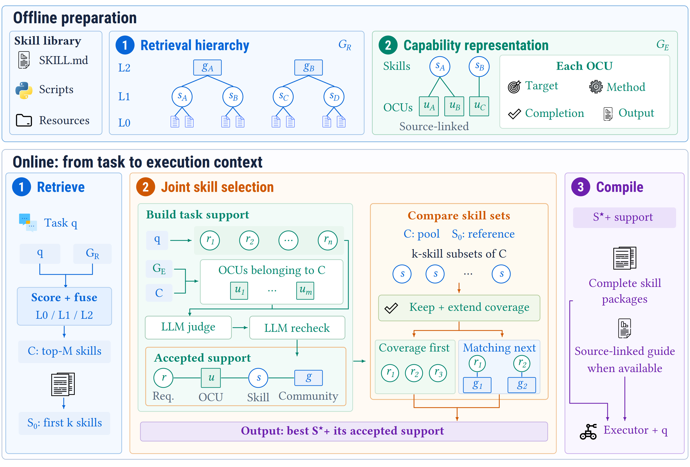
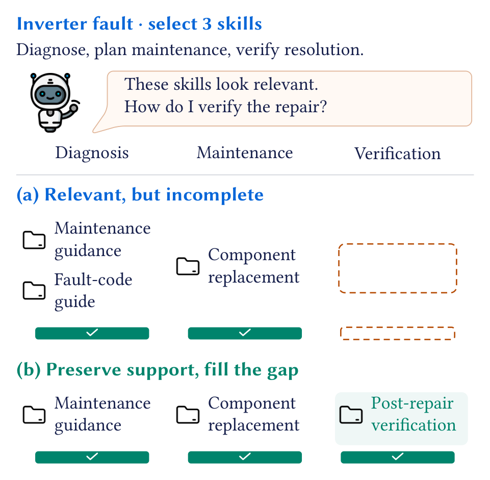

# SkillRAE: Support-Aware Skill Selection for Retrieval-Augmented Execution

[Paper](paper/SkillRAE.pdf) · [arXiv](https://arxiv.org/abs/2605.10114)

SkillRAE retrieves candidate skills, matches task requirements to documented
capabilities, and jointly selects complete packages under a fixed skill budget.
Source-linked guidance connects the selected capabilities to execution.

## Method overview

[](assets/figures/method_overview.png)

Offline construction prepares a retrieval hierarchy and source-linked capabilities.
Online, task requirements guide joint selection that preserves and extends support
under a fixed skill budget. Complete selected packages and their guidance reach the executor.

<details>
<summary>Why support-aware selection? — Figure 1</summary>

<p align="center">

</p>

Relevant skills can provide overlapping guidance while leaving a task requirement
unsupported. This illustrative example adds verification support while preserving
diagnosis and maintenance support under the same budget.

</details>

[Figure credits](assets/figures/CREDITS.md).

## Install and try

Use Python 3.12 or newer:

```bash
python -m venv .venv
source .venv/bin/activate
python -m pip install -e . -c requirements-replay.txt
skillrae select examples/selection.json
```

The example selects `s1` and `s3`: it preserves the original critical support
and adds support for another requirement using the same two skill slots.

For a real task with recorded retrieval and semantic inputs:

```bash
skillrae replay reproduce/agentskillos --output ./replay-output
```

This recomputes selection and execution guidance for `data_computation_task1`.
The [reproduction guide](docs/REPRODUCING.md) covers the 30 bundled AgentSkillOS
tasks. SkillsBench recorded-input replay is not included in this release.

## Use SkillRAE with your inputs

```bash
skillrae requirements /data/tasks/task-id/instruction.md --root /data
skillrae source-graph /data/skills --root /data
skillrae --preset skillsbench ocu-candidates /data/skills /data/foundation_profiles.json --root /data
skillrae select /data/task_selection.json
```

These commands extract requirements, parse skill sources, construct OCU
candidates from assessed source profiles, and select a set from accepted support.
The [pipeline guide](docs/PIPELINE.md) describes the Python interfaces for retrieval,
semantic assessment, and guide compilation, together with their input formats.
Complete selected packages and their source-linked guide form the execution context.

## Method map

| Component | Source in `skillrae/` |
|---|---|
| Source blocks and retrieval communities | `local_block_graph.py`, `source_scoped_l0.py` |
| Candidate retrieval | `retrieval.py`, block projection and score fusion |
| Operational capability units (OCUs) | `capability_units_v3.py` |
| Task requirements and pair nomination | `compiler.py`, `nomination.py` |
| Semantic support judgment and review | `binding_judge.py` |
| Fixed-budget joint selection | `mechanism_policies_v2.py` |
| Source-linked execution guidance | `runtime_guide.py` |

An OCU describes Target, Method, Completion, and Output for one operation.
The source field `action` corresponds to Target in the paper.

## Models

For live semantic assessment, set `OPENAI_API_KEY` and `OPENAI_BASE_URL` to your
Responses-compatible provider. Choose a configuration before starting the process:

```bash
export SKILLRAE_MODEL_PRESET=skillsbench
skillrae models
```

The current run presets use **`gpt-5.5` for both capability construction and requirement binding**.

| Preset | Capability construction | Requirement binding |
|---|---|---|
| `default` | `gpt-5.5` | `gpt-5.5` |
| `skillsbench` | `gpt-5.5` | `gpt-5.5` |
| `agentskillos` | `gpt-5.5` | `gpt-5.5` |

`SKILLRAE_CONSTRUCTION_MODEL` and `SKILLRAE_BINDING_MODEL` override individual
settings. Without a preset, the `default` row applies. Recorded-input replay
uses its stored inputs and original model metadata.
Retrieval embeddings use the optional dependency `pip install -e '.[retrieval]'`.
Selection and recorded-input replay require no API credentials.

## Further reading

- [Pipeline interfaces and input schema](docs/PIPELINE.md)
- [Reproduction and resources](docs/REPRODUCING.md)
- [Evaluation settings](docs/EVALUATION.md)

Run local checks with `python -m unittest discover -s tests -v`.
